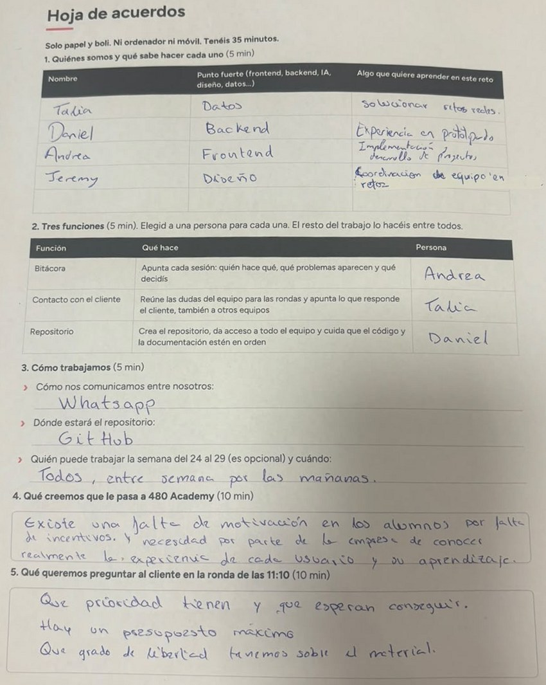

[Inicio](README.md) · [Especificación](SPEC.md) · **Bitácora** · [Decisiones](docs/decisiones.md) · [Propuestas](propuestas/README.md) · [Contribución](CONTRIBUTING.md)

# Bitácora

Registro de las sesiones de trabajo del Equipo C: actividades, coordinación, reparto de tareas, problemas y soluciones. Responsable: Andrea. Las entradas se ordenan de la más reciente a la más antigua.

---

## Sesión 2 · Martes 24/11/2026

**Asistentes:**

### Actividades

- Estructura base del frontend en `frontend/`: aplicación React instalable como PWA, con las pantallas del boceto, el estilo de los prototipos y respuestas simuladas mientras se decide la IA. Pendiente de revisión en una pull request.
- Propuesta P6 para votar las pantallas nuevas de los prototipos: bienvenida, alias anónimo y perfil.
- Tablero de tareas en GitHub Projects ([Reto 480 · Equipo C](https://github.com/users/andreaperibaz/projects/1)) con el backlog del proyecto: 15 tareas creadas como issues en el repositorio, cada una con su etiqueta y sus dependencias.

### Reparto de tareas

| Nombre | Tareas |
|---|---|
| Andrea | Estructura base del frontend, tablero de tareas y backlog, bitácora |

### Problemas y soluciones

| Problema | Solución |
|---|---|
| No teníamos una forma común de saber qué tareas quedaban ni quién se encargaba de cada una. | Creamos un tablero en GitHub Projects con todas las tareas pendientes. Las tareas se asignan en equipo y cada tarjeta avanza por las columnas a medida que se trabaja. |

### Herramientas de IA utilizadas

| Herramienta | Modelo | Uso |
|---|---|---|
| Claude (claude.ai) | Claude Opus 5.5 | Generación de la estructura del frontend, prototipos de pantallas, redacción del backlog y script para crear los issues |

---

## Sesión 1 · Lunes 23/11/2026

**Asistentes:** Daniel, Jeremy, Talia, Andrea

### Actividades

- Presentación del equipo. Daniel, Jeremy y Talia estudian Ingeniería Informática en la UJI; Andrea procede de FP.
- Lluvia de ideas sobre los cuatro problemas planteados por 480 Academy.
- Reunión con el cliente: preguntas sobre el caso y presentación de la propuesta.

### Hoja de acuerdos

Comunicación por WhatsApp y repositorio en GitHub. Para la semana del 24 al 29, todos pueden trabajar entre semana por las mañanas.

**Qué creemos que le pasa a 480 Academy:** existe una falta de motivación en los alumnos por falta de incentivos, y la empresa necesita conocer realmente la experiencia de cada usuario y su aprendizaje.

**Preguntas preparadas para el cliente:**
- Qué prioridad tienen y qué esperan conseguir.
- Si hay un presupuesto máximo.
- Qué grado de libertad tenemos sobre el material.

Páginas completas de la sesión: [hoja de acuerdos](docs/img/originales/hoja-acuerdos.jpg) · [flujo del alumno y respuesta a los problemas](docs/img/originales/flujo-y-respuestas.jpg) · [arquitectura](docs/img/originales/arquitectura.jpg).

### Ideas iniciales

- Un test inicial que detecte lo que el alumno ya sabe para poder omitirlo.
- Modos de uso según el contexto: sin audio (por ejemplo, en el autobús) o con poco tiempo disponible.
- Una IA que actúe como mentor y que, en lugar de esperar preguntas, intervenga cuando el alumno se bloquea o pierde interés.
- Adaptar el material a preferencias visuales o auditivas. Más tarde descartamos esta idea (véase "Problemas y soluciones").

### Información obtenida del cliente

En la ronda de preguntas, el cliente nos indicó que:
- Lo prioritario es que los alumnos aprendan.
- El material puede acortarse; los vídeos pueden dividirse por secciones.
- El público objetivo es muy amplio.
- No hay un presupuesto máximo ni mínimo para la IA; se valorará la propuesta más interesante.
- Los exámenes actuales duran entre 15 y 20 minutos.
- La suscripción da acceso a todos los cursos.
- Otros equipos han propuesto certificados o logros al completar un curso.

En la presentación de la propuesta:
- El cliente valoró positivamente nuestra propuesta.
- Nos sugirió buscar una alternativa a Flutter más adecuada a nuestras necesidades.

### Reparto de tareas

| Nombre | Tareas |
|---|---|
| Daniel | Gestión del repositorio |
| Talia | Contacto con el cliente |
| Jeremy | Sin tareas asignadas en esta sesión, por coincidir con otra presentación |
| Andrea | Bitácora |

### Problemas y soluciones

| Problema | Solución |
|---|---|
| Habíamos elegido Flutter para el frontend, pero el cliente sugirió otra opción: Flutter Web carga demasiado para conexiones 4G. | Adoptamos React como PWA ([Decisiones §1](docs/decisiones.md#1-stack-tecnológico)). |
| La primera versión de la especificación planteaba que la IA reemplazaría a los tutores, cuando el cliente pide mejorar su trabajo. | Reformulamos el planteamiento: el mentor asume el seguimiento diario y deriva a un tutor humano cuando es necesario. |
| El panel para tutores no encaja con la petición de centrarse en el alumno. | Lo planteamos como evolución futura, fuera del prototipo. |

### Roles técnicos acordados

| Nombre | Área |
|---|---|
| Daniel | Backend (Python + FastAPI) |
| Jeremy | Diseño (interfaz y experiencia móvil) |
| Talia | Base de datos (PostgreSQL) |
| Andrea | Frontend (React PWA) |

### Herramientas de IA utilizadas

| Herramienta | Modelo | Uso |
|---|---|---|
| Claude (claude.ai) | Claude Opus 5.5 | Organización del repositorio, redacción de la especificación, las decisiones, la política de privacidad y la estimación de coste y de esta bitácora |

---

<!-- Plantilla para nuevas entradas

## Sesión N · DD/MM/AAAA

**Asistentes:**

### Actividades
### Reparto de tareas
### Problemas y soluciones
### Cambios del cliente
### Herramientas de IA utilizadas

-->
