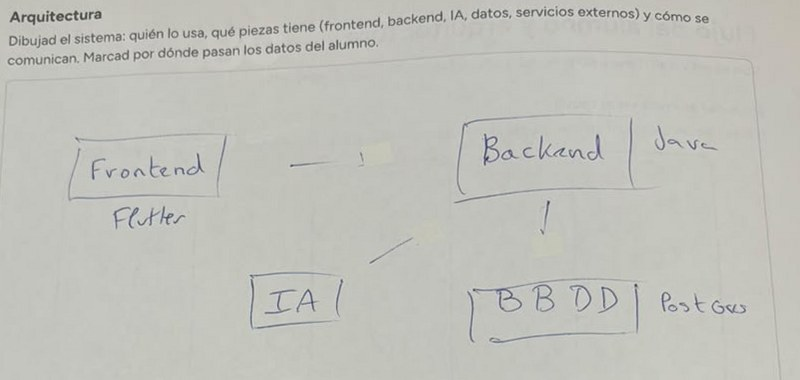

[Inicio](README.md) · **Especificación** · [Bitácora](BITACORA.md) · [Decisiones](docs/decisiones.md) · [Propuestas](propuestas/README.md) · [Contribución](CONTRIBUTING.md)

# Especificación

Paquete de diseño elaborado en la sesión 1 (23/11). Define el alcance del prototipo del 30/11.

**Índice:** [1. Alumno](#1-el-alumno-y-su-problema) · [2. Flujo](#2-flujo-del-alumno) · [3. Problemas](#3-respuesta-a-los-cuatro-problemas) · [4. Historias](#4-historias-de-usuario) · [5. Arquitectura](#5-arquitectura) · [6. Datos e IA](#6-modelo-de-datos-y-flujo-hacia-la-ia) · [7. Agentes](#7-agentes-de-ia) · [8. Contenido](#8-contenido) · [9. Coste](#9-coste-de-ia-por-alumno-y-mes) · [10. Propuesta original](#10-idea-original) · [11. Alcance](#11-alcance-para-el-3011)

---

## 1. El alumno y su problema

Adulto o adolescente, con perfiles y experiencia muy diversos, que estudia principalmente desde el móvil y en periodos cortos. Recibe el mismo itinerario que el resto de alumnos: revisa contenido que ya domina o se pierde si parte de cero, y no recibe el acompañamiento cercano que se le ofreció.

---

## 2. Flujo del alumno

| # | Pantalla | Descripción |
|---|---|---|
| 1 | Selección de curso | Lista de cursos disponibles. |
| 2 | Test inicial | Preguntas tipo test para conocer el nivel del alumno. |
| 3 | Vídeo | Reproductor del vídeo con su descripción. |
| 4 | Actividades | Ejercicios de verdadero o falso y de respuesta escrita. |
| 5 | Tutor | Chat con el tutor virtual ("¿Dudas?"). |
| 6 | Progreso | Recorrido del curso con las etapas completadas y la meta. |

---

## 3. Respuesta a los cuatro problemas

| Problema | Respuesta |
|---|---|
| **Los alumnos se saltan los vídeos** | Vídeos más cortos, gamificados y adaptados al nivel del alumno. |
| **Los itinerarios son iguales para todos** | Itinerarios personalizados según el nivel y el tipo de estudiante. |
| **No se sabe si el alumno aprende** | Seguimiento continuo mediante actividades durante el módulo, no solo con el examen final. |
| **El acompañamiento no llega a todos** | Un tutor virtual que pregunta al alumno y al que el alumno puede preguntar, con un papel proactivo. |

---

## 4. Historias de usuario

Pendiente de aprobación del equipo. Propuesta en votación: [P2. Historias de usuario](propuestas/README.md#p2-historias-de-usuario).

---

## 5. Arquitectura

El diagrama en papel recoge el planteamiento inicial (frontend en Flutter y backend en Java). Tras la sesión, el stack pasó a React PWA y Python con FastAPI ([decisiones §1](docs/decisiones.md#1-stack-tecnológico)).

| Pieza | Tecnología | Función |
|---|---|---|
| Frontend | React PWA | Aplicación que usa el alumno desde el móvil |
| Backend | Python + FastAPI | Lógica de la aplicación; comunica el frontend con la base de datos y con la IA |
| Base de datos | PostgreSQL | Almacena los datos de la aplicación |
| IA | Pendiente ([propuesta P1](propuestas/README.md#p1-agentes-de-ia)) | Funciones de IA del sistema |

Esquema detallado pendiente de aprobación: [propuesta P3](propuestas/README.md#p3-arquitectura-detallada-modelo-de-datos-y-privacidad).

---

## 6. Modelo de datos y flujo hacia la IA

Pendiente de aprobación del equipo. Propuesta en votación: [P3. Arquitectura detallada, modelo de datos y privacidad](propuestas/README.md#p3-arquitectura-detallada-modelo-de-datos-y-privacidad).

---

## 7. Agentes de IA

Pendiente de decisión del equipo. Propuesta en votación: [P1. Agentes de IA](propuestas/README.md#p1-agentes-de-ia).

---

## 8. Contenido

Pendiente de aprobación del equipo. Propuesta en votación: [P4. Contenido del curso de muestra](propuestas/README.md#p4-contenido-del-curso-de-muestra).

---

## 9. Coste de IA por alumno y mes

Pendiente de decisión del equipo. Propuesta en votación: [P1. Agentes de IA](propuestas/README.md#p1-agentes-de-ia).

---

## 10. Idea original

### Modos de estudio

El alumno puede elegir distintos modos según su situación: por ejemplo, actividades que no requieren escuchar si va en el autobús y no puede usar audio, o una sesión adaptada al tiempo que tiene si solo dispone de 10 minutos. El aprendizaje se adapta a las necesidades y características del usuario.

---

## 11. Alcance para el 30/11

Pendiente de definir por el equipo.
