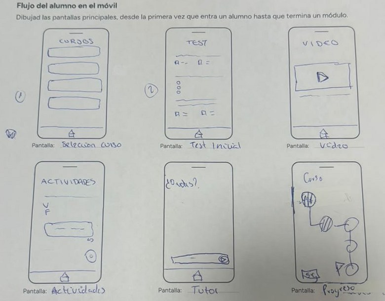
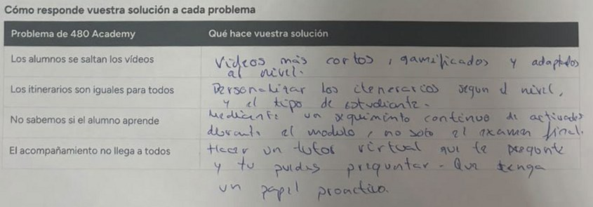
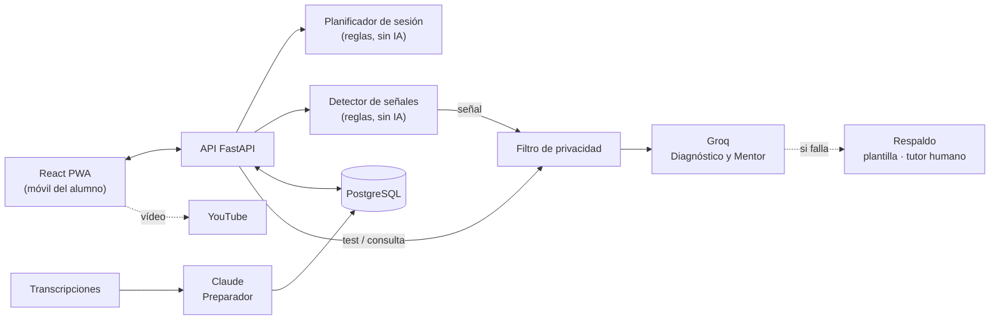
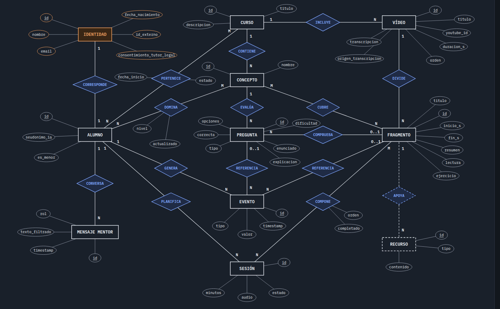

[Inicio](README.md) · **Especificación** · [Bitácora](BITACORA.md) · [Decisiones](docs/decisiones.md) · [Propuestas](propuestas/README.md) · [Contribución](CONTRIBUTING.md)

# Especificación

Paquete de diseño elaborado en la sesión 1 (23/11) y completado con las propuestas aprobadas en la reunión del 24/11. Define el alcance del prototipo del 30/11. El detalle de cada parte está en las [propuestas](propuestas/README.md).

**Índice:** [1. Alumno](#1-el-alumno-y-su-problema) · [2. Flujo](#2-flujo-del-alumno) · [3. Problemas](#3-respuesta-a-los-cuatro-problemas) · [4. Historias](#4-historias-de-usuario) · [5. Arquitectura](#5-arquitectura) · [6. Datos e IA](#6-modelo-de-datos-y-flujo-hacia-la-ia) · [7. Agentes](#7-agentes-de-ia) · [8. Contenido](#8-contenido) · [9. Coste](#9-coste-de-ia-por-alumno-y-mes) · [10. Propuesta original](#10-idea-original) · [11. Alcance](#11-alcance-para-el-3011)

---

## 1. El alumno y su problema

Adulto o adolescente, con perfiles y experiencia muy diversos, que estudia principalmente desde el móvil y en periodos cortos. Recibe el mismo itinerario que el resto de alumnos: revisa contenido que ya domina o se pierde si parte de cero, y no recibe el acompañamiento cercano que se le ofreció.

---

## 2. Flujo del alumno

| # | Pantalla | Descripción |
|---|---|---|
| 1 | Selección de curso | Lista de cursos disponibles. |
| 2 | Test inicial | Preguntas tipo test para conocer el nivel del alumno. |
| 3 | Vídeo | Reproductor del vídeo con su descripción. |
| 4 | Actividades | Ejercicios de verdadero o falso y de respuesta escrita. |
| 5 | Mentor | Chat con el mentor, el tutor virtual con IA ("¿Dudas?"). En el boceto se llamaba "Tutor". |
| 6 | Progreso | Recorrido del curso con las etapas completadas y la meta. |

Pantallas añadidas en la [propuesta P6](propuestas/README.md#p6-pantallas-de-bienvenida-alias-y-perfil), procedentes de los prototipos:

| # | Pantalla | Descripción |
|---|---|---|
| 7 | Bienvenida | Pantalla inicial la primera vez que se abre la aplicación. |
| 8 | Alias anónimo | El alumno elige un alias con un avatar; en modo anónimo, los tutores le ven con ese alias. |
| 9 | Perfil | Alias y modo anónimo, cursos, datos que usa la IA, modo de estudio habitual, tamaño del texto y tema. |

La barra inferior tiene cuatro pestañas: Hoy, Progreso, Mentor y Perfil.

**Nomenclatura** (acordada el 25/11/2026): "mentor" es siempre la IA y "tutor", la persona de la academia.

---

## 3. Respuesta a los cuatro problemas

| Problema | Respuesta |
|---|---|
| **Los alumnos se saltan los vídeos** | Vídeos más cortos, gamificados y adaptados al nivel del alumno. |
| **Los itinerarios son iguales para todos** | Itinerarios personalizados según el nivel y el tipo de estudiante. |
| **No se sabe si el alumno aprende** | Seguimiento continuo mediante actividades durante el módulo, no solo con el examen final. |
| **El acompañamiento no llega a todos** | Un mentor con IA que pregunta al alumno y al que el alumno puede preguntar, con un papel proactivo, y que deriva a un tutor de la academia cuando hace falta. |

---

## 4. Historias de usuario

Aprobadas el 24/11/2026 ([propuesta P2](propuestas/README.md#p2-historias-de-usuario)). Cada historia es una issue del [tablero](https://github.com/Daniel-al435456/Reto480EquipoC/issues) con responsable y estimación.

| # | Como… | Quiero… | Para… | Prioridad | Criterios de aceptación |
|---|---|---|---|---|---|
| H1 | alumno nuevo | realizar un test inicial breve | no revisar contenido que ya conozco | Imprescindible | Duración ≤ 6 min (≤ 12 preguntas). Dificultad adaptativa. Al finalizar se muestra el mapa con cada concepto clasificado como dominado, a repasar o nuevo. |
| H2 | alumno | que el itinerario omita lo que ya domino | mantener el interés | Imprescindible | Los fragmentos de conceptos dominados no aparecen en el itinerario y siguen accesibles desde "Ver todo". |
| H3 | alumno sin auriculares | seleccionar un modo sin audio | estudiar en cualquier lugar | Imprescindible | En modo sin audio solo se ofrecen lecturas, actividades y preguntas. No se reproduce vídeo con sonido. |
| H4 | alumno con poco tiempo | indicar 5, 10 o 20 minutos disponibles | completar la sesión en ese tiempo | Imprescindible | La sesión propuesta se ajusta al tiempo elegido (±1 min) y muestra la duración estimada antes de empezar. |
| H5 | alumno | responder 2 o 3 preguntas tras cada fragmento | comprobar que lo he entendido | Imprescindible | La comprobación aparece al final de cada fragmento. Un fallo marca el concepto como "a repasar" y se refleja en el mapa. |
| H6 | alumno bloqueado | recibir ayuda sin tener que pedirla | no abandonar | Imprescindible | Tras 2 fallos en el mismo concepto, o al abandonar un fragmento antes de la mitad, el mentor ofrece una explicación alternativa en ≤ 3 s, basada exclusivamente en el contenido del curso. |
| H7 | alumno | consultar dudas al mentor y solicitar un tutor | sentirme acompañado | Deseable | El mentor responde con contenido del curso y cita el fragmento. La opción "Hablar con un tutor" registra la derivación. |
| H8 | alumno, o su familia si es menor | conocer y borrar los datos que usa la IA | confiar en la plataforma | Deseable | La pantalla de privacidad muestra los datos enviados a la IA. La opción de borrado elimina el historial del mentor. |
| H9 | alumno | acceder al mentor desde cualquier pantalla mediante un símbolo de IA | resolver dudas sin perder el punto en el que estoy | Deseable | Botón visible en todas las pantallas salvo el test inicial y la bienvenida. Abre el chat con la lección actual como contexto. |
| — | tutor | consultar un panel de alumnos en riesgo | priorizar mi dedicación | Fuera de alcance | El cliente ha solicitado centrar el prototipo en el alumno. Se plantea como evolución. |

---

## 5. Arquitectura

El diagrama en papel recoge el planteamiento inicial (frontend en Flutter y backend en Java). Tras la sesión, el stack pasó a React PWA y Python con FastAPI ([decisiones §1](docs/decisiones.md#1-stack-tecnológico)).

| Pieza | Tecnología | Función |
|---|---|---|
| Frontend | React PWA | Aplicación que usa el alumno desde el móvil |
| Backend | Python + FastAPI | Lógica de la aplicación; comunica el frontend con la base de datos y con la IA |
| Base de datos | PostgreSQL | Almacena los datos de la aplicación |
| IA | Claude (Preparador) y Groq (Diagnóstico y Mentor) | Prepara el contenido de cada vídeo y redacta el diagnóstico y las respuestas del mentor ([§7](#7-agentes-de-ia)) |

Esquema detallado, aprobado en la [propuesta P3](propuestas/datos-y-privacidad.md#arquitectura-detallada). Los datos del alumno pasan siempre por el filtro de privacidad antes de llegar a la IA:

| Pieza | Explicación |
|---|---|
| React PWA | Interfaz mobile-first e instalable. Guarda en caché la aplicación para tolerar conexiones 4G inestables. Nunca llama a la IA directamente. |
| API FastAPI | Punto único de entrada: test, sesión, eventos y mentor. |
| Planificador de sesión | Reglas sin IA: elige fragmentos y actividades según el mapa de dominio, el tiempo y el audio. |
| Detector de señales | Reglas sin IA sobre los eventos (fallos seguidos, abandono): decide cuándo interviene el mentor. |
| Filtro de privacidad | Único módulo que habla con la IA. Sustituye la identidad por un seudónimo y limpia los datos personales del texto. |
| PostgreSQL | Identidad separada de los datos de aprendizaje, eventos y contenido preparado. |
| Claude (Preparador) | Genera el material de cada vídeo una sola vez, antes de la demo. No recibe datos de alumnos. |
| Groq (Diagnóstico y Mentor) | Responde en tiempo real con datos seudonimizados. Si falla, actúa el respaldo. |

---

## 6. Modelo de datos y flujo hacia la IA

Aprobado el 24/11/2026 ([propuesta P3](propuestas/datos-y-privacidad.md#modelo-de-datos-y-flujo-hacia-la-ia), con el diagrama entidad-relación).

**Entidades principales**

| Entidad | Contenido | ¿Llega a la IA? |
|---|---|---|
| Empresa | Empresas clientes de la academia | Nunca |
| Identidad | Nombre, apellidos, email, hash de la contraseña, fecha de nacimiento, empresa, identificador externo, consentimiento de la familia y aceptación de la privacidad | Nunca. El backend calcula a partir de la fecha si el alumno es menor |
| Alumno | Seudónimo para la IA, alias, modo anónimo, si usa el mentor con IA, personalidad del mentor y tratamiento | El seudónimo, la personalidad, el tratamiento y si es menor (calculado) |
| Curso, Vídeo, Lección, Concepto, Pregunta, Recurso | Contenido del curso y material preparado | Sí (es contenido de la academia) |
| Dominio (Alumno – Concepto) | Nivel por concepto | Sí, agregado |
| Evento, Sesión | Respuestas, vídeos vistos, sesiones | Solo eventos recientes agregados |
| MensajeMentor | Conversación con el mentor, ya filtrada | Sí; se elimina a los 90 días |

**Cómo se cumple la condición de privacidad**

| Se envía a la IA | No se envía |
|---|---|
| Seudónimo aleatorio, distinto del identificador interno | Nombre, email, teléfono, fecha de nacimiento |
| Indicador de minoría de edad (para ajustar el tono) | Edad exacta |
| Nivel por concepto y eventos recientes agregados | Historial completo de navegación |
| Texto de las consultas tras el filtro de privacidad | Texto libre sin filtrar |
| Fragmentos del curso | Datos de pago o suscripción |

- **Filtro de privacidad:** todas las llamadas pasan por un único módulo del backend, que sustituye la identidad por el seudónimo, elimina del texto emails, teléfonos, DNI/NIE, direcciones y el nombre del alumno, y envía solo los campos de una lista blanca.
- **Menores:** la IA solo recibe si el alumno es menor, nunca su edad. Con menos de 14 años se registra el consentimiento de la familia. El mentor usa un tono adaptado y deriva a un humano ante señales de malestar. La IA recomienda, pero no decide: el alumno puede elegir cualquier contenido.
- **Proveedor:** Groq no entrena con los datos del cliente y solo recibe datos seudonimizados. El Preparador solo recibe transcripciones.
- **Conservación y derechos:** mensajes del mentor durante 90 días; de las llamadas a la IA solo se guardan metadatos. La pantalla de privacidad muestra qué se envía a la IA y permite borrar el historial.
- **Base legal:** ejecución del contrato de formación. El uso del mentor se informa en el alta y puede desactivarse.

---

## 7. Agentes de IA

Aprobados el 24/11/2026 ([propuesta P1](propuestas/README.md#p1-agentes-de-ia), con una ficha por agente en [propuestas/agentes](propuestas/agentes/)). El planificador de sesión y el detector de señales funcionan sin IA, a propósito: son predecibles, gratuitos y comprobables.

| Agente | Qué hace | Modelo y por qué | Entrada | Salida | Límites |
|---|---|---|---|---|---|
| **Preparador** | Divide cada vídeo en fragmentos de unos 5 minutos y genera resumen, versión en texto para el modo sin audio, preguntas del test inicial y comprobaciones. | **Claude.** Se ejecuta una sola vez por vídeo, antes de la demo, así que se prioriza la calidad del contenido en español. | Transcripción con marcas de tiempo y metadatos del catálogo | JSON validado contra un esquema, revisable por un tutor | No recibe datos de alumnos. Salida JSON estricta. |
| **Diagnóstico** | Traduce la nota por concepto del test inicial (calculada por el backend) a dominado, a repasar o nuevo, y explica al alumno su itinerario. | **Groq, `gpt-oss-20b`.** Responde en tiempo real, con plan gratuito suficiente para el prototipo. Respaldo: plantilla fija sin IA. | Seudónimo, indicador de minoría de edad y resultados por concepto | Clasificación por concepto y mensaje de 80 palabras como máximo | No calcula la puntuación, que es determinista. No recibe datos personales. |
| **Mentor** | Acompaña al alumno ante señales (2 fallos seguidos, abandono de un fragmento) y responde a sus dudas. | **Groq, `gpt-oss-120b`.** Respuesta en menos de 3 s y sin coste en el prototipo. Respaldo: mensaje fijo y derivación al tutor humano. | Señal o consulta filtrada, nivel por concepto y 1 a 3 fragmentos del curso | Mensaje breve con una acción concreta o derivación a un tutor | Solo usa el contenido del curso y cita el fragmento. No da respuestas del examen final ni pide datos personales. Máximo 30 mensajes al día por alumno. Deriva a un humano ante señales de malestar. |

---

## 8. Contenido

Aprobado el 24/11/2026 ([propuesta P4](propuestas/README.md#p4-contenido-del-curso-de-muestra)).

- **Curso:** *Python desde cero*. Encaja con una academia de formación profesional y tecnológica, tiene alumnos con niveles previos muy variados (lo que pone a prueba el test inicial) y hay mucho material en español.
- **Vídeos:** 12 vídeos públicos de YouTube de un mismo curso, de entre 5 y 25 minutos. La selección está pendiente.
- **Transcripciones:** si el vídeo tiene subtítulos (como el 30 % del catálogo real), se usan directamente; si no, se transcriben con Whisper en un servidor propio, sin coste por llamada y sin enviarlos a terceros.
- **Texto derivado:** resúmenes, lecturas, preguntas y comprobaciones los genera una sola vez por vídeo el agente Preparador y se guardan en la base de datos. En producción, un tutor los revisa antes de publicarlos.

---

## 9. Coste de IA por alumno y mes

Aprobado el 24/11/2026 ([propuesta P1, "Coste estimado"](propuestas/README.md#coste-estimado)).

**En el prototipo:** el diagnóstico y el mentor no tienen coste (plan gratuito de Groq). El único gasto es preparar el contenido de los vídeos de la demo con Claude: unos céntimos, una sola vez.

**En producción con un proveedor de pago** (estimación con Claude Haiku 5.5 para el tiempo real y Sonnet 5.5 por lotes para el Preparador):

| Hipótesis para un alumno activo medio | Coste |
|---|---|
| 12 sesiones al mes, 4 intervenciones del mentor por sesión (48 llamadas), unos 3.000 tokens de entrada (la mitad en caché) y 250 de salida por llamada, y un diagnóstico al mes | **≈ 0,015 USD por alumno y mes** |
| Con margen ×3 para uso intensivo | **≈ 0,05 USD por alumno y mes** |
| 1.200 alumnos | Entre 18 y 60 USD al mes |
| Preparación única de los 400 vídeos del catálogo | Unos 13 USD en total |

**Cómo se reduce:**
- El contenido se genera una vez por vídeo, no por alumno.
- El planificador y el detector de señales no usan IA.
- Las instrucciones del mentor se guardan en caché.
- El contexto del mentor se limita a unos 8.000 tokens.
- Máximo 30 mensajes al día por alumno.
- Se reutilizan las respuestas frecuentes por fragmento.

---

## 10. Idea original

### Modos de estudio

El alumno puede elegir distintos modos según su situación: por ejemplo, actividades que no requieren escuchar si va en el autobús y no puede usar audio, o una sesión adaptada al tiempo que tiene si solo dispone de 10 minutos. El aprendizaje se adapta a las necesidades y características del usuario.

---

## 11. Alcance para el 30/11

Según las prioridades aprobadas en [§4](#4-historias-de-usuario):

| Entra | Historias |
|---|---|
| Sí, imprescindible | H1 test inicial, H2 itinerario sin lo que ya domina, H3 modo sin audio, H4 sesión de 5, 10 o 20 minutos, H5 comprobaciones, H6 mentor proactivo |
| Si da tiempo (deseable) | H7 dudas al mentor y tutor humano, H8 datos que usa la IA y borrado, H9 mentor desde cualquier pantalla |
| No | Panel de tutores: el cliente pidió centrar el prototipo en el alumno |

Del mentor proactivo se implementan las señales de bloqueo (2 fallos seguidos) y abandono; inactividad y racha quedan para después. Sin ellas el mentor sigue respondiendo cuando el alumno pregunta.
