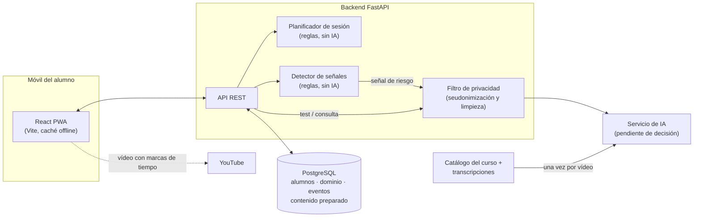

<sub>[Inicio](README.md) · **Especificación** · [Bitácora](BITACORA.md) · [Decisiones](docs/decisiones.md) · [Privacidad](docs/privacidad.md) · [Propuestas](propuestas/README.md) · [Contribución](CONTRIBUTING.md)</sub>

# Especificación

Paquete de diseño elaborado en la sesión 1 (23/11). Define el alcance del prototipo del 30/11.

**Índice:** [1. Alumno](#1-el-alumno-y-su-problema) · [2. Flujo](#2-flujo-del-alumno) · [3. Problemas](#3-respuesta-a-los-cuatro-problemas) · [4. Historias](#4-historias-de-usuario) · [5. Arquitectura](#5-arquitectura) · [6. Datos e IA](#6-modelo-de-datos-y-flujo-hacia-la-ia) · [7. Agentes](#7-agentes-de-ia) · [8. Contenido](#8-contenido) · [9. Coste](#9-coste-de-ia-por-alumno-y-mes) · [10. Propuesta original](#10-idea-original) · [11. Alcance](#11-alcance-para-el-3011)

---

## 1. El alumno y su problema

Adulto o adolescente (desde 14 años), con perfiles y experiencia muy diversos, que estudia principalmente desde el móvil y en periodos cortos. Recibe el mismo itinerario que el resto de alumnos: revisa contenido que ya domina o se pierde si parte de cero, y no recibe el acompañamiento cercano que se le ofreció.

---

## 2. Flujo del alumno

Boceto en papel: `docs/img/boceto.jpg` (pendiente de incorporar).

---

## 3. Respuesta a los cuatro problemas

| Problema | Respuesta |
|---|---|
| **Los alumnos se saltan los vídeos** (38 % de visualización completa) | Los vídeos largos se dividen en fragmentos de unos 5 minutos mediante marcas de tiempo, sin reeditar el material. Solo se muestra el contenido que el alumno no domina. Cada fragmento termina con una comprobación, de modo que el progreso depende de la comprensión y no de la reproducción. |
| **Itinerarios iguales para todos** | El test inicial genera un mapa de dominio por concepto: lo dominado se omite, lo débil se repasa y lo nuevo se presenta. El mapa se actualiza con cada comprobación. El modo contexto adapta además el formato a la situación del alumno. |
| **No se sabe si el alumno aprende** | Se registran eventos en cada punto del recorrido: respuestas del test, comprobaciones, fragmentos completados o abandonados y solicitudes de ayuda. El resultado es una evolución del dominio por concepto, más allá de "reproducido / aprobado". |
| **Acompañamiento insuficiente** (6 tutores para 1.200 alumnos) | El mentor de IA asume el seguimiento cotidiano: motivación, resolución de bloqueos y recordatorios. Interviene de forma proactiva ante señales de riesgo y deriva a un tutor humano cuando no puede resolver una situación o el alumno lo solicita. No sustituye a los tutores: reduce su carga repetitiva para que se centren en los casos que lo requieren. |

---

## 4. Historias de usuario

| # | Como… | Quiero… | Para… | Prioridad | Criterios de aceptación |
|---|---|---|---|---|---|
| H1 | alumno nuevo | realizar un test inicial breve | no revisar contenido que ya conozco | Imprescindible | Duración ≤ 6 min (≤ 12 preguntas). Dificultad adaptativa. Al finalizar se muestra el mapa con cada concepto clasificado como dominado, a repasar o nuevo. |
| H2 | alumno | que el itinerario omita lo que ya domino | mantener el interés | Imprescindible | Los fragmentos de conceptos dominados no aparecen en el itinerario y siguen accesibles desde "Ver todo". |
| H3 | alumno sin auriculares | seleccionar un modo sin audio | estudiar en cualquier lugar | Imprescindible | En modo sin audio solo se ofrecen lecturas, actividades y preguntas. No se reproduce vídeo con sonido. |
| H4 | alumno con poco tiempo | indicar 5, 10 o 20 minutos disponibles | completar la sesión en ese tiempo | Imprescindible | La sesión propuesta se ajusta al tiempo elegido (±1 min) y muestra la duración estimada antes de empezar. |
| H5 | alumno | responder 2 o 3 preguntas tras cada fragmento | comprobar que lo he entendido | Imprescindible | La comprobación aparece al final de cada fragmento. Un fallo marca el concepto como "a repasar" y se refleja en el mapa. |
| H6 | alumno bloqueado | recibir ayuda sin tener que pedirla | no abandonar | Imprescindible | Tras 2 fallos en el mismo concepto, o al abandonar un fragmento antes de la mitad, el mentor ofrece una explicación alternativa en ≤ 3 s, basada exclusivamente en el contenido del curso. |
| H7 | alumno | consultar dudas al mentor y solicitar un tutor | sentirme acompañado | Deseable | El mentor responde con contenido del curso y cita el fragmento. La opción "Hablar con un tutor" registra la derivación. |
| H8 | alumno, o su familia si es menor | conocer y borrar los datos que usa la IA | confiar en la plataforma | Deseable | La pantalla de privacidad muestra los datos enviados a la IA. La opción de borrado elimina el historial del mentor. |
| — | tutor | consultar un panel de alumnos en riesgo | priorizar mi dedicación | Fuera de alcance | El cliente ha solicitado centrar el prototipo en el alumno. Se plantea como evolución (§10). |

---

## 5. Arquitectura

Diagrama en papel: `docs/img/arquitectura.jpg` (pendiente de incorporar).



| Componente | Función |
|---|---|
| **React PWA** | Interfaz mobile‑first, utilizable con una mano y con las acciones principales en la zona del pulgar. Almacena en caché la interfaz y el texto de la sesión para tolerar conexiones 4G inestables. |
| **API FastAPI** | Punto único de entrada: autenticación simulada en el prototipo y endpoints de test, sesión, eventos y mentor. |
| **Planificador de sesión** | Lógica determinista, sin IA. A partir del mapa de dominio, el tiempo disponible y la disponibilidad de audio, selecciona fragmentos y actividades. Es predecible, no tiene coste y se puede probar. |
| **Detector de señales** | Reglas sobre los eventos registrados (fallos consecutivos, abandono, inactividad, racha). Determina cuándo interviene el mentor. |
| **Filtro de privacidad** | Toda llamada a la IA pasa por este módulo, que sustituye la identidad por un seudónimo y elimina datos personales del texto libre. Detalle en [docs/privacidad.md](docs/privacidad.md). |
| **Servicio de IA** | Pendiente de decisión del equipo ([propuesta P1](propuestas/README.md#p1-agentes-de-ia)). |
| **PostgreSQL** | Datos del alumno separados en identidad y aprendizaje, eventos y contenido preparado. |
| **Integración** | La plataforma actual no dispone de API. El prototipo se diseña como servicio independiente con API propia, integrable posteriormente mediante SSO, LTI 1.3 y xAPI. |

---

## 6. Modelo de datos y flujo hacia la IA

**Entidades principales**

```
Identidad(id, nombre, email, fecha_nacimiento, consentimiento_tutor_legal)   -- nunca se envía a la IA
Alumno(id, id_externo, seudonimo_ia UUID, franja_edad, es_menor, curso_id)
Concepto(id, curso_id, nombre)
Fragmento(id, video_id, inicio_s, fin_s, conceptos[], resumen, actividad_sin_audio)
Pregunta(id, concepto_id, dificultad, enunciado, opciones, correcta, tipo: diagnostico|micro)
Dominio(alumno_id, concepto_id, nivel 0..1, actualizado)
Evento(alumno_id, tipo, fragmento_id?, pregunta_id?, valor, timestamp)
Sesion(alumno_id, minutos, audio, fragmentos[], estado)
MensajeMentor(alumno_id, rol, texto_filtrado, timestamp)   -- se elimina a los 90 días
```

**Datos enviados a la IA**

| Se envía | No se envía |
|---|---|
| Seudónimo aleatorio, distinto del identificador interno | Nombre, email, teléfono, fecha de nacimiento |
| Franja de edad e indicador de minoría de edad (para ajustar el tono) | Edad exacta |
| Nivel por concepto y eventos recientes agregados | Historial completo de navegación |
| Texto de las consultas tras el filtro de privacidad | Texto libre sin filtrar |
| Fragmentos del curso (contenido de la academia) | Datos de pago o suscripción |

Base legal, tratamiento de menores, proveedor, conservación y derechos: [docs/privacidad.md](docs/privacidad.md).

---

## 7. Agentes de IA

Pendiente de decisión del equipo. Propuesta en votación: [P1. Agentes de IA](propuestas/README.md#p1-agentes-de-ia).

---

## 8. Contenido

- **Curso:***Python desde cero*. Encaja con una academia de formación profesional y tecnológica, presenta niveles previos muy variados (lo que pone a prueba el test inicial) y dispone de abundante material en español.
- **Vídeos:** 12 vídeos públicos de YouTube de un mismo curso, de entre 5 y 25 minutos (selección pendiente).
- **Transcripciones:** 1. Si el vídeo dispone de subtítulos (como el 30 % del catálogo real), se utilizan directamente.
  2. En caso contrario, se transcriben con Whisper en servidor propio, sin coste por llamada y sin envío a terceros.
- **Material derivado:** se genera una sola vez por vídeo y se almacena en la base de datos (método pendiente de la [propuesta P1](propuestas/README.md#p1-agentes-de-ia)). En producción, un tutor lo revisa antes de publicarlo.

---

## 9. Coste de IA por alumno y mes

Pendiente de decisión del equipo. Propuesta en votación: [P1. Agentes de IA](propuestas/README.md#p1-agentes-de-ia).

---

## 10. Idea original

### Modo contexto

El cliente solicitó itinerarios personalizados según el conocimiento del alumno. La propuesta añade una personalización según su **situación**. El 71 % del tráfico procede del móvil, y en el móvil se estudia en desplazamientos, esperas o pausas de pocos minutos. Proponer en ese momento un vídeo de 25 minutos con audio conduce al abandono, y es una causa probable del 38 % de visualización completa.

Con el modo contexto, el alumno indica el tiempo y la disponibilidad de audio y recibe una sesión que puede completar en ese intervalo. Completar sesiones breves favorece el hábito de estudio, que es condición necesaria para el aprendizaje.

> **Nota de diseño.** No se adapta el contenido a "estilos de aprendizaje" (visual, auditivo, etc.): la evidencia disponible no muestra que ajustar el formato al estilo declarado mejore el aprendizaje. La adaptación se basa en el contexto real (posibilidad de escuchar, tiempo disponible) y en técnicas respaldadas por la investigación: práctica de recuperación tras cada fragmento y repaso espaciado. Véase [docs/decisiones.md](docs/decisiones.md#3-decisión-de-producto).

**Evolución prevista (fuera del prototipo):** panel para tutores con los alumnos que requieren atención y el motivo, alimentado por las derivaciones del mentor.

---

## 11. Alcance para el 30/11

Pendiente de definir por el equipo.
