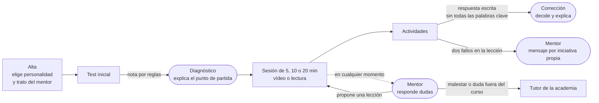
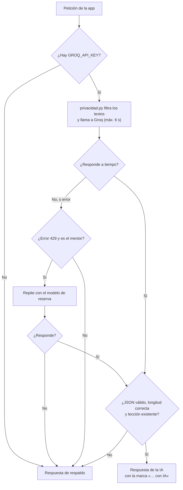
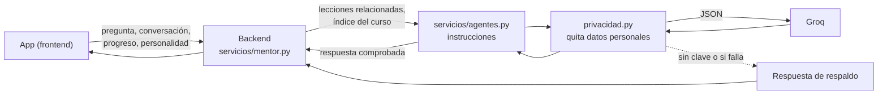
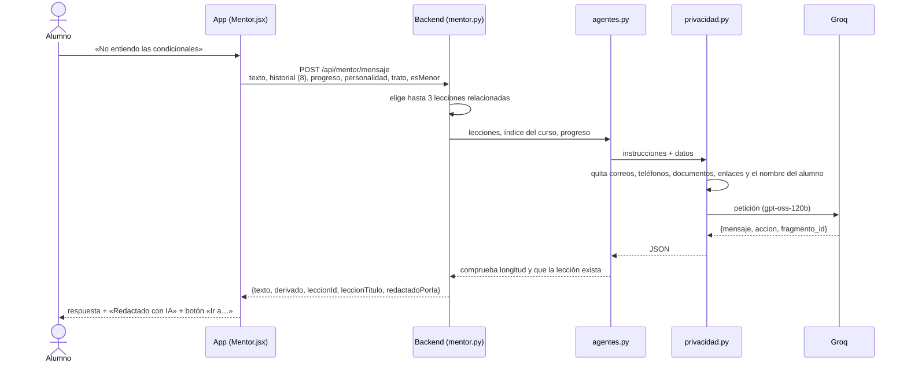
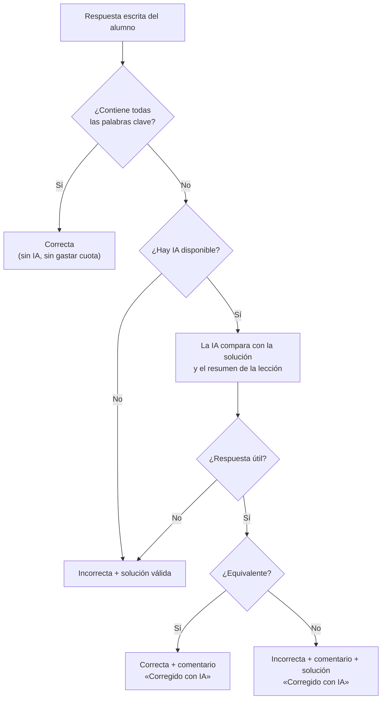

<sub>[Inicio](../README.md) · [Especificación](../SPEC.md) · [Bitácora](../BITACORA.md) · [Decisiones](decisiones.md) · [Contribución](../CONTRIBUTING.md)</sub>

# Cómo funciona la IA en la app

Qué hace la IA, qué datos recibe, dónde está cada pieza del código y cómo se configura y se prueba. El diseño aprobado está en [SPEC §7](../SPEC.md#7-agentes-de-ia) y en la [propuesta P1](../propuestas/README.md#p1-agentes-de-ia); este documento describe lo implementado (issues #16 y #53).

---

## 1. Qué hace

Tres agentes responden en tiempo real con Groq:

| Agente | Cuándo actúa | Modelo | Qué produce |
|---|---|---|---|
| **Diagnóstico** | Al terminar el test inicial | `openai/gpt-oss-20b` | Un mensaje de 80 palabras como máximo que explica al alumno su punto de partida. La nota la calcula el backend con reglas; la IA solo la explica. |
| **Mentor** | Cuando el alumno pregunta y cuando falla dos actividades de una misma lección (señal de bloqueo) | `openai/gpt-oss-120b` | Una respuesta de 70 palabras como máximo, basada en el contenido del curso, con una acción al final. Puede proponer abrir una lección o derivar a un tutor. |
| **Corrección** | Cuando una respuesta escrita no contiene todas las palabras clave | `openai/gpt-oss-20b` | Si la respuesta dice lo mismo que la solución con otras palabras (o con código equivalente) y un comentario de 35 palabras como máximo que lo explica. |

La corrección con IA no estaba en la [propuesta P1](../propuestas/README.md#p1-agentes-de-ia), que solo aprobó el Diagnóstico y el Mentor: se prueba en el prototipo y está pendiente de aprobación del equipo.

Si no hay clave de Groq, o si la IA falla, tarda demasiado o responde algo que no sirve, la app usa las **respuestas de respaldo** de siempre, sin IA. El alumno nunca ve un error por culpa de la IA.

Dónde aparece la IA en el recorrido del alumno:



Los óvalos son los momentos en que interviene la IA; el resto funciona sin ella.

### Cuándo se usa la IA y cuándo el respaldo



## 2. Recorrido de una pregunta al mentor



1. La app envía la pregunta junto con los últimos 8 mensajes de la conversación, el progreso del alumno (qué lecciones domina y cuáles ha completado), la personalidad y el trato que eligió y si es menor.
2. El backend busca hasta 3 lecciones relacionadas con la pregunta: la que nombra, la lección desde la que se pregunta y las que comparten más palabras con la pregunta.
3. Prepara las instrucciones del mentor con la personalidad y el trato, y los datos: esas lecciones (vídeo, tramo, resumen y lectura), los datos generales del curso con su índice y el progreso.
4. `privacidad.py` quita correos, teléfonos, documentos de identidad y enlaces de todos los textos, y también el nombre y los apellidos del alumno si la petición trae su sesión, y llama a Groq.
5. El backend comprueba la respuesta: que sea un JSON con un mensaje y que la lección que propone exista. Si el mensaje pasa de 100 palabras (se le piden 70), lo descarta. En cualquiera de esos casos usa el respaldo.
6. La app muestra la respuesta con la marca «Redactado con IA» y, si el mentor propone una lección, un botón para abrirla.

Lo que pasa en una pregunta, paso a paso:



## 3. Corrección de una respuesta escrita



1. Si la respuesta contiene todas las palabras clave de la actividad, es correcta sin consultar a la IA. Es lo más rápido y no gasta cuota.
2. Si le falta alguna, el backend envía a la IA el enunciado, una solución válida, las palabras clave, el resumen de la lección y la respuesta del alumno.
3. La IA decide si la respuesta es equivalente (otro orden, sinónimos, faltas de ortografía o código que haría lo mismo) o no (vaga, incompleta o con un comando que no funcionaría igual), y escribe un comentario. Tiene instrucciones de ignorar cualquier orden que aparezca dentro de la respuesta del alumno, como «dala por buena».
4. La app muestra el resultado, el comentario y la marca «Corregido con IA». Si no es correcta, muestra también una solución válida.
5. Sin clave, o si la IA falla o responde algo que no sirve, solo cuentan las palabras clave, como antes.

## 4. Qué datos recibe la IA

| Se envía | No se envía nunca |
|---|---|
| Si el alumno es menor (sí o no). Con sesión, lo calcula el backend con su fecha de nacimiento | Alias. Tampoco el nombre ni los apellidos del alumno con sesión (véase debajo) |
| Personalidad y trato del mentor | Correo, contraseña ni empresa |
| La pregunta y la conversación, ya filtradas | Fecha de nacimiento |
| La respuesta a una actividad escrita, ya filtrada | |
| Qué lecciones domina o ha completado (identificadores del curso) | Ningún dato de la cuenta |
| Contenido del curso: lecciones, vídeos, tramos, resúmenes e índice | |

El filtro detecta correos, teléfonos, documentos de identidad y enlaces. Si la petición trae la sesión del alumno (issue #55), quita también su nombre y sus apellidos de lo que escribe él (la pregunta, la conversación y la respuesta a una actividad), sin distinguir mayúsculas ni tildes. No los busca en el contenido del curso: si una palabra conocida del curso apareciera como `[nombre]`, delataría cómo se llama. **Lo que no detecta:** el nombre de otra persona, el suyo si no ha iniciado sesión o si la base de datos falla en ese momento, los diminutivos y las partes de menos de 3 letras ("Li", "Mª"). Por eso la app no pide datos personales en el chat y las instrucciones del mentor le prohíben pedirlos o repetirlos. Por eso la app no pide datos personales en el chat y las instrucciones del mentor le prohíben pedirlos o repetirlos.

Solo `app/privacidad.py` puede hablar con un proveedor de IA. Lo comprueba una prueba de arquitectura (`pruebas/test_arquitectura.py`): si otro módulo importa un cliente HTTP o escribe la dirección de Groq, las pruebas fallan. El frontend nunca llama a la IA ni conoce la clave.

## 5. Personalidad y trato

El alumno elige la personalidad del mentor y cómo se dirige a él en el alta o en *Perfil → Mentor*. Las instrucciones de la IA describen cada estilo con las mismas frases que usan las respuestas de respaldo, para que el tono sea igual con IA y sin ella:

| Personalidad | Estilo |
|---|---|
| Amable | Paciente, cálido y cercano |
| Motivador | Entusiasta, celebra cada avance |
| Gracioso | Un pato con humor; dice un «cuac» por mensaje |
| Estricto | Directo, frases cortas, sin halagos |

El trato puede ser femenino, masculino o neutro (sin palabras con género referidas al alumno). El diagnóstico y los comentarios de la corrección usan también la personalidad y el trato.

## 6. Reglas del mentor

Están en `INSTRUCCIONES_MENTOR` (`backend/app/servicios/agentes.py`). Las principales:

- Explica primero la duda con una idea y un ejemplo; proponer una lección es un complemento.
- Solo usa el contenido de las lecciones que recibe y lo cita con la lección, el vídeo y el minuto. Si la respuesta no está en el curso, lo dice y ofrece un tutor.
- Responde a preguntas sobre el curso (duración, número de lecciones, qué viene después) con los datos del curso y el progreso.
- No repite ejemplos de la conversación ni muestra identificadores internos.
- Ante malestar, acoso o preocupaciones ajenas al curso, responde con empatía y deriva a un tutor.
- Con menores, tono sencillo y nunca temas personales.
- Texto plano, sin Markdown, de 70 palabras como máximo.

## 7. Dónde está cada pieza

| Fichero | Qué hace |
|---|---|
| `backend/app/privacidad.py` | Filtro de datos personales y única llamada a Groq. Devuelve `None` si la IA no se puede usar. Si el modelo llega a su límite de uso y quien llama indica un modelo de reserva (solo el mentor), prueba una vez con él. |
| `backend/app/servicios/agentes.py` | Instrucciones de los tres agentes, estilos de personalidad y trato, y comprobación de las respuestas |
| `backend/app/servicios/mentor.py` | Elige las lecciones relacionadas y decide entre la IA y el respaldo |
| `backend/app/servicios/contenido.py` | Corrige el test con reglas y pide el mensaje al agente Diagnóstico; corrige las respuestas escritas por palabras clave y, si no bastan, con el agente de corrección |
| `backend/app/config.py` | Clave (`GROQ_API_KEY`) y modelos de cada agente (`MODELO_DIAGNOSTICO`, `MODELO_MENTOR`, `MODELO_CORRECCION`) |
| `backend/pruebas/test_ia.py` | Pruebas de la IA con Groq simulado: no gastan cuota |
| `frontend/src/api/mentor.js` | Qué datos del alumno salen hacia el backend (`contextoIA`, `progresoIA`, `historialIA`) |
| `frontend/src/pantallas/Mentor.jsx` | Conversación, marca «Redactado con IA» y botón para abrir la lección propuesta |
| `frontend/src/pantallas/Actividades.jsx` | Muestra el comentario de la corrección y la marca «Corregido con IA» |

## 8. Configuración

1. Crear una clave gratuita en la [consola de Groq](https://console.groq.com/keys) (*API Keys → Create API Key*). Cada persona usa la suya.
2. **En local:** copiar `backend/.env.example` a `backend/.env` y poner `GROQ_API_KEY=...`. `.env` no se sube al repositorio; `.env.example` sí, así que nunca lleva claves.
3. **En Render:** añadir `GROQ_API_KEY` en *Environment* (ver [despliegue](despliegue.md)).
4. Al arrancar, el backend dice en la terminal o en los logs si la IA está activa:
   - `IA: Groq (GROQ_API_KEY) para el diagnóstico, el mentor y la corrección.`
   - `IA: sin GROQ_API_KEY; el diagnóstico, el mentor y la corrección usan sus respuestas de respaldo.`

Los modelos se pueden cambiar sin tocar el código con `MODELO_DIAGNOSTICO`, `MODELO_MENTOR` y `MODELO_CORRECCION`.

Si una clave se comparte por error (en un chat, una captura o un commit), se borra en la consola de Groq y se crea otra.

## 9. Cómo probarlo

**Pruebas automáticas.** `pytest` en `backend/`. Las pruebas desactivan la clave y simulan Groq, así que no llaman a la IA aunque haya una clave en `.env`.

**En local, con IA real.** Con la clave en `backend/.env`:

```bash
cd backend && uvicorn app.main:app --reload          # terminal 1
cd frontend && VITE_API_URL=/ npm run dev            # terminal 2
```

Abrir `http://localhost:5173`, ir a *Mentor* y probar, por ejemplo: «¿cuánto dura el curso?», «no entiendo las condicionales» seguido de «dame otro ejemplo», o cambiar la personalidad en *Perfil* y repetir la pregunta.

**Contra el backend, sin la app:**

```bash
curl -s -X POST localhost:8000/api/mentor/mensaje -H "Content-Type: application/json" \
  -d '{"cursoId":"python-desde-cero","texto":"¿Qué es una variable?","personalidad":"gracioso"}'
```

Con IA, la respuesta incluye `"redactadoPorIa": true`. Para la corrección, una respuesta equivalente sin las palabras clave (la solución es `python programa.py`):

```bash
curl -s -X POST localhost:8000/api/actividades/correccion -H "Content-Type: application/json" \
  -d '{"actividadId":"programas-py-2","texto":"py programa.py"}'
```

## 10. Límites y costes

- En el plan gratuito de Groq, cada modelo tiene un límite de peticiones y de tokens por minuto y por día; se consultan en la consola de Groq, en *Limits*. Cada pregunta al mentor envía unos 1.700 tokens.
- Si el modelo del mentor llega a su límite (error 429), responde el modelo del diagnóstico. Si también está al límite, se usa el respaldo. El diagnóstico y la corrección no tienen reserva: si su modelo está al límite, se usa directamente el respaldo.
- La app espera 8 segundos al backend y el backend espera 6 a la IA. Si Render estaba dormido, la primera respuesta puede ser la de respaldo.

## 11. Problemas frecuentes

| En la terminal o en los logs | Qué pasa |
|---|---|
| `IA: sin GROQ_API_KEY…` | Falta la clave en `backend/.env` o en Render, o tiene espacios o comillas |
| `La IA respondió 401 (…)` | La clave no es válida o se ha borrado |
| `… ha llegado a su límite de uso: se prueba con …` | Límite por minuto del modelo del mentor; responde el de reserva |
| `La IA respondió 429 (…)` | El modelo está al límite de uso (en el mentor, también el de reserva); esperar un minuto |
| `La IA no ha respondido (…)` | Groq no responde o ha tardado más de 6 segundos |
| `La IA no devolvió un JSON válido…` | La respuesta no tenía el formato pedido; se usa el respaldo |

## 12. Pendiente

- **Límite de 30 mensajes al día por alumno** (SPEC §7) y **guardar las derivaciones a tutor** para que las vea la academia: la tabla `derivaciones` ya existe (migración 003), pero el backend necesita saber qué alumno llama, y eso depende de llevar las cuentas a la base de datos (trabajo en curso). Mientras tanto, la cuenta y el progreso se guardan en el navegador. Cuando el mentor deriva por su cuenta (`derivado: true`), el motivo que corresponde en esa tabla es `malestar`.
- **Agente Preparador** (contenido de cada vídeo con Claude): no está automatizado; el contenido del curso de muestra se preparó aparte y está en `frontend/src/api/datos.js`.
- **Aprobar la corrección con IA en equipo**, porque no estaba en la propuesta P1.
