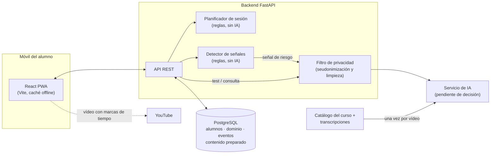

<sub>[Volver a propuestas](README.md) · Propuesta P3, pendiente de votación</sub>

# P3. Arquitectura detallada, modelo de datos y privacidad

## Arquitectura detallada



| Componente | Función |
|---|---|
| **React PWA** | Interfaz mobile‑first, utilizable con una mano y con las acciones principales en la zona del pulgar. Almacena en caché la interfaz y el texto de la sesión para tolerar conexiones 4G inestables. |
| **API FastAPI** | Punto único de entrada: autenticación simulada en el prototipo y endpoints de test, sesión, eventos y mentor. |
| **Planificador de sesión** | Lógica determinista, sin IA. A partir del mapa de dominio, el tiempo disponible y la disponibilidad de audio, selecciona fragmentos y actividades. Es predecible, no tiene coste y se puede probar. |
| **Detector de señales** | Reglas sobre los eventos registrados (fallos consecutivos, abandono, inactividad, racha). Determina cuándo interviene el mentor. |
| **Filtro de privacidad** | Toda llamada a la IA pasa por este módulo, que sustituye la identidad por un seudónimo y elimina datos personales del texto libre. Detalle en el apartado "Privacidad". |
| **Servicio de IA** | Pendiente de decisión del equipo ([propuesta P1](README.md#p1-agentes-de-ia)). |
| **PostgreSQL** | Datos del alumno separados en identidad y aprendizaje, eventos y contenido preparado. |
| **Integración** | La plataforma actual no dispone de API. Se diseña como servicio independiente con API propia, integrable posteriormente mediante SSO, LTI 1.3 y xAPI. |

## Modelo de datos y flujo hacia la IA

**Entidades principales**

```
Identidad(id, nombre, email, fecha_nacimiento, consentimiento_tutor_legal)   -- nunca se envía a la IA
Alumno(id, id_externo, seudonimo_ia UUID, es_menor, curso_id)
Concepto(id, curso_id, nombre)
Fragmento(id, video_id, inicio_s, fin_s, conceptos[], resumen, actividad_sin_audio)
Pregunta(id, concepto_id, dificultad, enunciado, opciones, correcta, tipo: diagnostico|micro)
Dominio(alumno_id, concepto_id, nivel 0..1, actualizado)
Evento(alumno_id, tipo, fragmento_id?, pregunta_id?, valor, timestamp)
Sesion(alumno_id, minutos, audio, fragmentos[], estado)
MensajeMentor(alumno_id, rol, texto_filtrado, timestamp)   -- se elimina a los 90 días
```

**Datos enviados a la IA**

| Se envía | No se envía |
|---|---|
| Seudónimo aleatorio, distinto del identificador interno | Nombre, email, teléfono, fecha de nacimiento |
| Indicador de minoría de edad (para ajustar el tono) | Edad exacta |
| Nivel por concepto y eventos recientes agregados | Historial completo de navegación |
| Texto de las consultas tras el filtro de privacidad | Texto libre sin filtrar |
| Fragmentos del curso (contenido de la academia) | Datos de pago o suscripción |

Base legal, tratamiento de menores, proveedor, conservación y derechos: véase "Privacidad".

## Privacidad

Entre los alumnos de 480 Academy hay menores de 18 años y la academia está sujeta al RGPD. Este documento describe cómo se garantiza que ningún dato personal identificable llegue a servicios de IA sin un tratamiento claro y justificado, tal como exige el enunciado.

> Este documento recoge un diseño técnico y no constituye asesoramiento jurídico. Antes del paso a producción debe revisarlo el delegado de protección de datos de 480 Academy.

---

### 1. Principio general

La IA no conoce la identidad del alumno. Los datos se separan en dos grupos que nunca se combinan en una llamada a la IA:

| Tabla | Contenido | Acceso de la IA |
|---|---|---|
| `Identidad` | Nombre, email, fecha de nacimiento, consentimiento | Nunca |
| `Alumno`, `Dominio`, `Evento` | Seudónimo aleatorio, indicador de minoría de edad, nivel por concepto, eventos | Solo los campos imprescindibles, seudonimizados |

El seudónimo es un UUID aleatorio distinto del identificador interno de la base de datos. Una llamada interceptada no permitiría identificar al alumno.

### 2. Filtro de privacidad

Todas las llamadas a la IA pasan por un único módulo del backend (`backend/app/privacidad.py`), que es el único punto del código autorizado a comunicarse con el proveedor. Sus funciones son:

1. **Sustitución de identidad.** Reemplaza cualquier identificador por el seudónimo.
2. **Limpieza de texto libre.** Detecta en las consultas del alumno emails, teléfonos, DNI/NIE, direcciones y su propio nombre, y los sustituye por marcadores (`[EMAIL]`, `[NOMBRE]`). En el prototipo se emplean expresiones regulares; en producción, una librería de detección de datos personales con soporte para español.
3. **Minimización.** Cada llamada a la IA recibe únicamente los campos incluidos en su lista blanca (véase "Modelo de datos").

### 3. Menores de edad

- La IA recibe solo el indicador de minoría de edad (menor de 18 o no), nunca la edad exacta.
- Con alumnos menores, el mentor adopta un tono adaptado y aplica instrucciones más estrictas: evita temas personales y deriva a un humano ante cualquier señal de malestar.
- Si hay alumnos menores de **14 años**, en España el tratamiento de sus datos requiere el consentimiento de sus progenitores o tutores legales. Dicho consentimiento se registra en `Identidad`.
- **No se toman decisiones automatizadas con efectos significativos.** La IA recomienda un itinerario, pero el alumno puede consultar y elegir cualquier contenido. La calificación del examen no depende de la IA.

### 4. Proveedor de IA

- En producción, el acceso se realiza a través de un proveedor cloud con procesamiento en la UE y contrato de encargado de tratamiento.
- Según las condiciones comerciales del proveedor, los datos enviados por API no se emplean para entrenar modelos. Este punto debe verificarse contractualmente antes del paso a producción.
- La generación de material a partir de los vídeos no recibe en ningún caso datos de alumnos: trabaja exclusivamente con las transcripciones.

### 5. Conservación y derechos

| Dato | Plazo de conservación | Finalidad |
|---|---|---|
| Mensajes con el mentor | 90 días | Continuidad de la conversación |
| Nivel por concepto y eventos agregados | Mientras dure la suscripción | Personalización del itinerario |
| Registros de llamadas a la IA | Solo metadatos (tokens, coste, latencia), sin contenido | Control del coste |

La pantalla **"Datos y privacidad"** muestra al alumno exactamente qué información se envía a la IA y le permite borrar su historial con el mentor, lo que hace efectivos los derechos de acceso y supresión.

### 6. Base legal

El tratamiento de los datos de aprendizaje se basa en la **ejecución del contrato** de formación, que incluye el acompañamiento. El uso del mentor de IA se informa en el alta y puede desactivarse.

